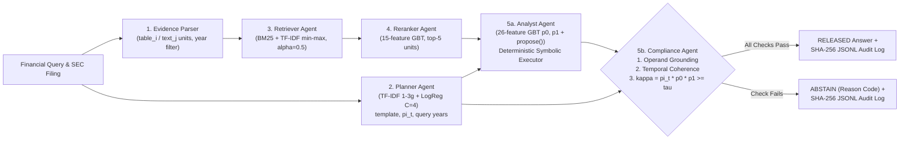
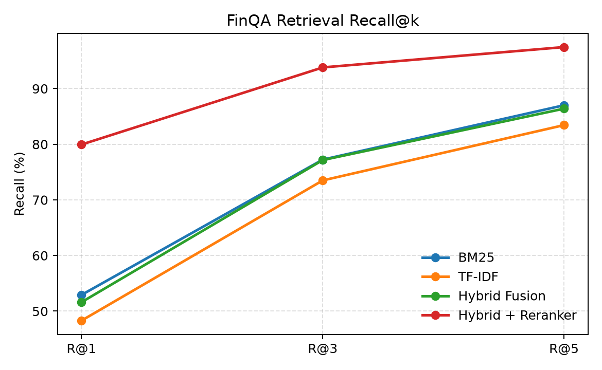
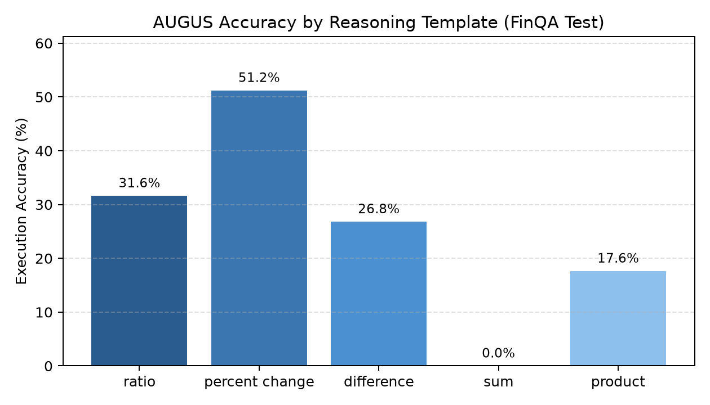
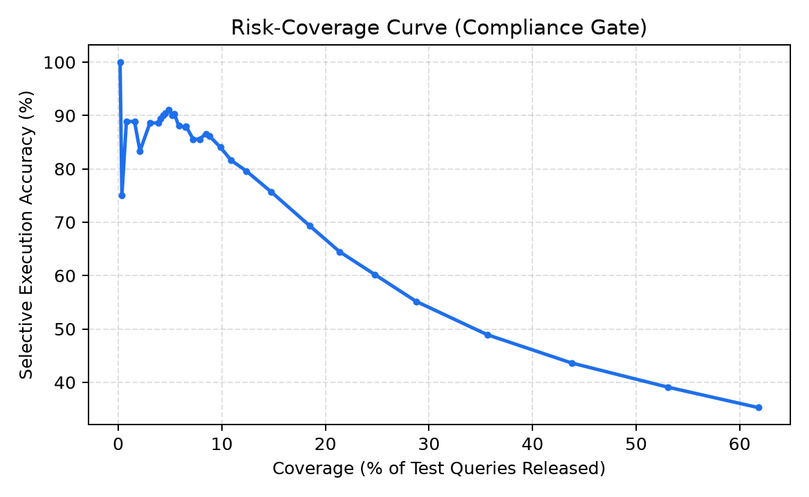

# AUGUS: A Multi-Agent Retrieval Augmented Generation Framework for Autonomous Financial Research and Compliance

[](https://ieeexplore.ieee.org/)
[](https://www.python.org/)
[](reproduce.py)
[](LICENSE)

**Authors:** Mridul Mishra, Aman Bhardwaj, Ashutosh Pal, Dr. Deepali Dev

Official reproducible implementation of **AUGUS**, a 5-agent CPU-reproducible framework for grounded financial question answering, deterministic symbolic execution, and auditable compliance gating on SEC filings ([FinQA](https://github.com/czyssrs/FinQA)).

---

## Architecture

AUGUS decomposes financial research and verification into five specialized agents with deterministic provenance tracking and a confidence-gated compliance release policy:



### Module Overview

| Component | Module | Specification |
| :--- | :--- | :--- |
| **Evidence Parser** | [`augus/parser.py`](augus/parser.py) | Preserves FinQA `table_i` / `text_j` indices, row labels, column headers, ~60-char text context; filters decimal-free integers in `[1980, 2039]` as years. |
| **Planner Agent** | [`augus/planner.py`](augus/planner.py) | Word 1–3 gram TF-IDF + Logistic Regression (`C=4`) classifying into `ratio`, `percent change`, `difference`, `sum`, `product`, `other`; extracts question years. |
| **Retriever Agent** | [`augus/retriever.py`](augus/retriever.py) | BM25 ($k_1=1.5, b=0.75$) and TF-IDF cosine similarity, min-max normalized per filing and fused with $\alpha=0.5$. |
| **Reranker Agent** | [`augus/reranker.py`](augus/reranker.py) | 15-feature Gradient Boosted Trees (`300` rounds, max `31` leaves, $\eta=0.08$) returning top-5 evidence units. |
| **Analyst Agent** | [`augus/analyst.py`](augus/analyst.py) | Modular `propose()` interface with 26 operand features, out-of-fold GBT role scorers ($p_0, p_1$; `400` rounds, `lr=0.06`, `L2=1.0`), and deterministic symbolic executor. |
| **Compliance Agent** | [`augus/compliance.py`](augus/compliance.py) | Computes $\kappa = \pi_t \cdot p_0(c_{i^*}) \cdot p_1(c_{j^*})$, enforces grounding, temporal coherence, and $\kappa \ge \tau$, and writes SHA-256 JSONL audit logs. |

---

## Quickstart

### 1. Install Dependencies

```bash
pip install -r requirements.txt
```

### 2. Run Unit Tests

```bash
pytest -v
```

### 3. Reproduce All Paper Benchmarks & Figures (CPU-only)

```bash
python reproduce.py --seed 42
```

`reproduce.py` automatically downloads the official MIT-licensed FinQA splits (`train.json`: 6,251 / `dev.json`: 883 / `test.json`: 1,147) into `data/finqa/`, trains all agents with `--seed 42`, tunes $\tau$ on FinQA `dev`, evaluates retrieval, ablations, and the falsified-operand grounding stress test on FinQA `test`, and writes all tables, audit logs, and figures to [`results/`](results/).

---

## Reproduced Benchmarks (FinQA Test, `n = 1,147`, `--seed 42`)

All numbers below are generated directly by [`reproduce.py`](reproduce.py) and saved in [`results/tables.md`](results/tables.md) and [`results/summary.json`](results/summary.json).

### Table 1: Retrieval Performance on FinQA Test Split (`n = 1,147`)

| Method | R@1 (%) | R@3 (%) | R@5 (%) | Full@5 (%) | MRR |
| :--- | :---: | :---: | :---: | :---: | :---: |
| BM25 ($k_1=1.5, b=0.75$) | 52.92 | 77.24 | 87.01 | 62.51 | 0.6726 |
| TF-IDF Cosine | 48.30 | 73.50 | 83.44 | 59.72 | 0.6317 |
| Hybrid Fusion ($\alpha=0.5$) | 51.61 | 77.16 | 86.40 | 62.86 | 0.6631 |
| **Hybrid + GBT Reranker** | **79.95** | **93.81** | **97.47** | **80.56** | **0.8752** |

### Table 2: End-to-End Accuracy, Ablations & Compliance Gate (FinQA Test)

_Compliance threshold tuned on FinQA dev: $\tau = 0.1300$_

| System Variant | Overall Acc (%) | Selective Acc (%) | 95% Bootstrap CI | McNemar $p$ vs. Baseline | Coverage (%) | CPU ms/query |
| :--- | :---: | :---: | :---: | :---: | :---: | :---: |
| Single-agent baseline | 4.97 | 5.07 | [3.84, 6.28] | — | 98.08 | 22.83 |
| AUGUS w/o reranker | 19.70 | 28.61 | [17.52, 22.06] | 1.25e-37 | 68.88 | 19.95 |
| AUGUS BM25-only | 25.11 | 35.82 | [22.58, 27.55] | 1.84e-51 | 70.10 | 33.77 |
| AUGUS w/o planner | 7.85 | 7.85 | [6.45, 9.33] | 3.76e-05 | 100.00 | 41.25 |
| AUGUS full | 25.11 | 35.82 | [22.58, 27.55] | 1.84e-51 | 70.10 | 36.38 |
| Gold-evidence oracle | 32.26 | 47.01 | [29.47, 34.87] | 3.97e-77 | 68.61 | 2249.08 |
| **AUGUS + Compliance gate** | 14.56 | **60.51** | [12.64, 16.56] | 1.60e-17 | 24.06 | 3233.84 |

### Table 3: Falsified-Operand Grounding Stress Test

| Metric | Value |
| :--- | :---: |
| Executable Test Programs Evaluated | 821 |
| Perturbed Operands Checked ($\times \{0.9, 0.95, 0.99, 1.01, 1.05, 1.1\}$) | 819 |
| Perturbation Detection Rate (Top-5 Evidence) | **100.00%** |
| Perturbation Detection Rate (Full Filing) | **100.00%** |
| False-Alarm Rate on Clean Gold Operands (Top-5) | 16.08% |
| False-Alarm Rate on Clean Gold Operands (Full Filing) | 8.77% |

---

## Figures

| Retrieval Recall@k | Accuracy by Reasoning Template | Risk-Coverage Curve |
| :---: | :---: | :---: |
|  |  |  |

Sample SHA-256 compliance audit log entries are recorded in [`results/audit_log_sample.jsonl`](results/audit_log_sample.jsonl).

---

## Limitations & Future Work

- **Program Coverage**: AUGUS currently executes single-step binary templates (`ratio`, `difference`, `sum`, `product`) and two-step `percent change` programs; multi-step compositions and constant-based programs (which account for 30.25% of the FinQA test set) are routed to `other` and safely abstained.
- **Domain Scope**: Experiments evaluate English US SEC filings (10-K/10-Q) from FinQA; cross-lingual and non-GAAP accounting standards require domain-specific parser rules.
- **Modular LLM Integration**: The Analyst Agent's `propose()` interface is designed as a drop-in boundary—future work can replace the GBT operand scorer with an LLM program generator while retaining the exact same deterministic Compliance Agent gate and SHA-256 audit trail.

---

## Interactive Web Runtime (Optional)

The repository also includes a FastAPI + LangGraph interactive web workspace under [`app/`](app/):

```bash
python -m uvicorn app.main:app --reload
```

---

## Citation

```bibtex
@inproceedings{mishra2026augus,
  title     = {AUGUS: A Multi-Agent Retrieval Augmented Generation Framework for Autonomous Financial Research and Compliance},
  author    = {Mishra, Mridul and Bhardwaj, Aman and Pal, Ashutosh and Dev, Deepali},
  booktitle = {Proceedings of the IEEE International Conference on Computing, Communication, Control, and AI (IC3AI)},
  year      = {2026}
}
```

## License

This project is licensed under the [MIT License](LICENSE).
